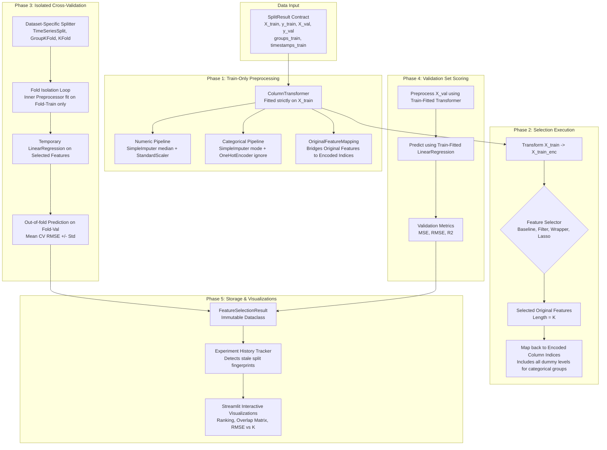

# Feature Selection Pipeline & Validation Architecture

This document details the architectural pipeline, cross-validation isolation protocols, data leakage prevention mechanisms, and experiment tracking state models for **Milestone 2**.

---

## 1. End-to-End Pipeline Architecture



---

## 2. Leakage-Free Cross-Validation Strategy

To ensure scientific integrity and eliminate subtle data leakage, cross-validation adheres to strict structural isolation:

### 2.1 Dataset-Specific CV Strategies
| Dataset | Splitting Strategy | Cross-Validation Strategy | Constraint Enforced |
| :--- | :--- | :--- | :--- |
| **Appliances Energy** | Temporal Split | `TimeSeriesSplit(n_splits=3)` | Chronological order ($t_{\text{train}} < t_{\text{val}}$), zero lookahead leakage |
| **King County House Sales** | Random Split | `KFold(n_splits=3, shuffle=True, seed=42)` | Independent cross-sectional observations |
| **Life Expectancy** | Group Split | `GroupKFold(n_splits=3)` | Strictly disjoint countries across folds via `groups_train` |
| **Student Performance** | Random Split | `KFold(n_splits=3, shuffle=True, seed=42)` | Independent student records |

### 2.2 Strict Fold Isolation Protocol
During each CV fold:
1. Imputers (median and mode) are fitted **only on fold-train observations**.
2. Encoders and scalers are fitted **only on fold-train observations**.
3. Feature selection algorithms are fitted **only on fold-train observations**.
4. The temporary `LinearRegression` estimator is fitted **only on fold-train observations**.
5. Predictions and errors are evaluated strictly on **fold-validation observations**.

> **Verification**: The codebase includes a verified `test_deliberate_leakage_trap()` demonstrating that naive pre-fitting on the whole training set produces artificially optimistic (lower) RMSE scores, verifying that our fold isolation prevents selection bias.

---

## 3. Evaluation Metrics & Temporary Estimator

A temporary `LinearRegression` model is used solely to evaluate feature subsets:

* **Mean Squared Error (MSE)**:
  $$\text{MSE} = \frac{1}{N_{\text{val}}} \sum_{i=1}^{N_{\text{val}}} (y_i - \hat{y}_i)^2$$
* **Root Mean Squared Error (RMSE)**:
  $$\text{RMSE} = \sqrt{\text{MSE}}$$
  Expressed in the target variable's original natural units.
* **Coefficient of Determination ($R^2$)**:
  $$R^2 = 1 - \frac{\sum_{i=1}^{N_{\text{val}}} (y_i - \hat{y}_i)^2}{\sum_{i=1}^{N_{\text{val}}} (y_i - \bar{y}_{\text{val}})^2}$$
  > **Pedagogical Note**: On out-of-sample validation data, $R^2$ can be negative if a model's predictions are worse than the simple baseline of predicting the validation target mean $\bar{y}_{\text{val}}$.

---

## 4. Experiment Result Architecture & Dimension Hierarchy

Each completed experiment is encapsulated in a `FeatureSelectionResult` dataclass with explicit four-tier dimension tracking:

```python
@dataclass
class FeatureSelectionResult:
    experiment_id: str                      # Stable SHA-256 hash of complete config
    dataset_id: str
    dataset_fingerprint: str
    split_fingerprint: str
    method_id: str
    method_name: str
    category: str
    requested_k: int

    # Four-Tier Dimension Hierarchy:
    total_original_count: int               # Total original predictors in dataset (P)
    selected_original_count: int            # Selected original predictors (K)
    full_encoded_dimension: int             # Full one-hot encoded matrix dimension (D_full)
    selected_encoded_dimension: int         # Active regression model input columns (D_sel)

    selected_original_features: List[str]
    all_original_features: List[str]
    encoded_feature_names: List[str]
    selected_encoded_feature_names: List[str]
    feature_mappings: List[OriginalFeatureMapping]

    cv_rmse_mean: float
    cv_rmse_std: float
    val_mse: float
    val_rmse: float
    val_r2: float
    execution_time_seconds: float
    cv_strategy_used: str
    cv_folds: int
    random_seed: int
    warnings: List[str]
    notes: str
```

### 4.1 Structural Feature Mapping
Feature grouping is implemented via **structural introspection** of fitted scikit-learn transformers (`preprocessor.output_indices_`, `transformers_`, and `OneHotEncoder.categories_`). It guarantees 100% collision immunity even when:
* Feature names share common substrings/prefixes (`feat` vs `feat_2`, `cat` vs `cat_type`).
* Categorical levels contain underscores (`level_1`, `val_x`).
* Datasets combine mixed continuous and multi-level categorical predictors.

### 4.2 Cryptographic SHA-256 Experiment Identity
To guarantee collision-free tracking across varying configurations, experiment IDs are generated as:
$$\text{ID} = \text{SHA256}(\text{DatasetFP} \,\|\, \text{SplitFP} \,\|\, \text{Method} \,\|\, K \,\|\, \text{CVStrategy} \,\|\, \text{CVFolds} \,\|\, \text{Seed} \,\|\, \alpha)[:12]$$
Runs with different CV folds, alpha penalties, or random seeds receive distinct hashes and never overwrite one another in the experiment tracker.

### 4.3 Stale State Invalidation
The `FeatureSelectionExperimentTracker` associates every run with the active `dataset_fingerprint` and `split_fingerprint`. If a user modifies split ratios, changes random seed, or switches datasets in `pages/dataset.py`, previous experiments are flagged as outdated, preventing cross-contamination.

---

## 5. Handoff to Milestone 3 Regression Modeling

The `FeatureSelectionResult` serves as the canonical input to the Milestone 3 Ordinary Least Squares Modeling Laboratory:

1. **Canonical Original Predictor Handoff**: Milestone 3 consumes the `selected_original_features` list (original domain variables, size $K$).
2. **Re-encoding for Econometric Identifiability**: While Milestone 2 may encode all categories for predictive feature selection, Milestone 3 rebuilds the numerical design matrix using reference-category dummy encoding (`drop='first'`) to guarantee full column rank when an intercept is present.
3. **Fingerprint Validation**: `train_ols_experiment()` verifies that `fs_result.split_fingerprint == split_result.split_fingerprint`, actively rejecting experiments derived from outdated splits.
4. **Post-Selection Inference Notice**: Models trained on feature-selected subsets automatically display:
   > *"Coefficient tests and confidence intervals are conventional OLS results conditional on the selected model. They do not automatically adjust for data-driven feature selection."*


