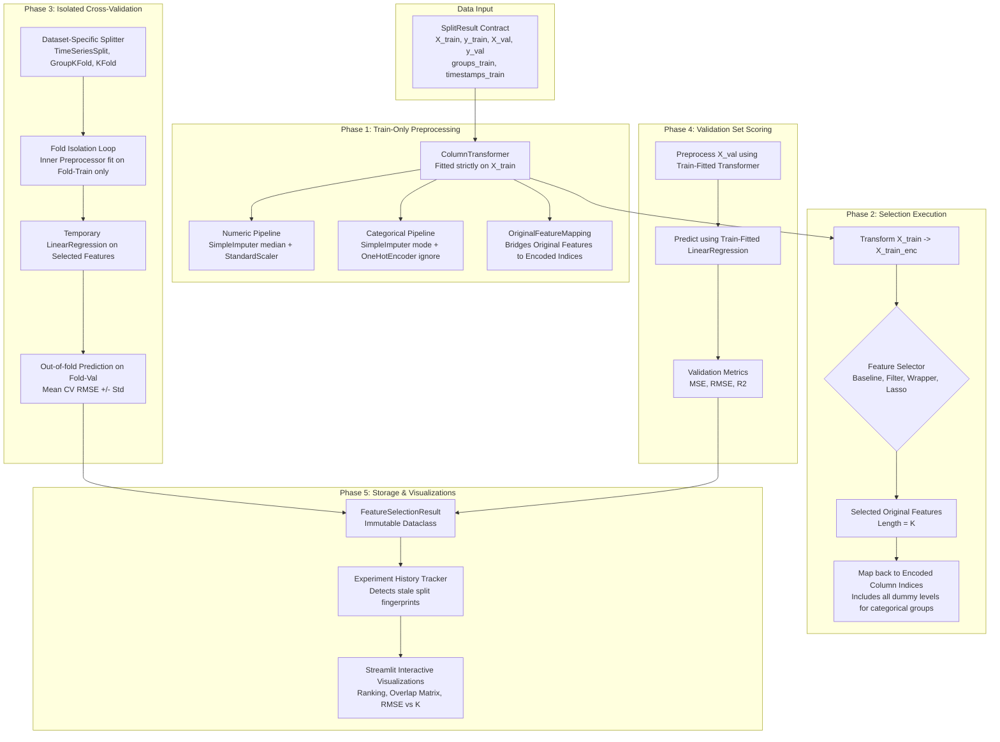

# Feature Selection Pipeline & Validation Architecture

This document details the architectural pipeline, cross-validation isolation protocols, data leakage prevention mechanisms, and experiment tracking state models for **Milestone 2**.

---

## 1. End-to-End Pipeline Architecture



---

## 2. Leakage-Free Cross-Validation Strategy

To ensure scientific integrity and eliminate subtle data leakage, cross-validation adheres to strict structural isolation:

### 2.1 Dataset-Specific CV Strategies
| Dataset | Splitting Strategy | Cross-Validation Strategy | Constraint Enforced |
| :--- | :--- | :--- | :--- |
| **Appliances Energy** | Temporal Split | `TimeSeriesSplit(n_splits=3)` | Chronological order ($t_{\text{train}} < t_{\text{val}}$), zero lookahead leakage |
| **King County House Sales** | Random Split | `KFold(n_splits=3, shuffle=True, seed=42)` | Independent cross-sectional observations |
| **Life Expectancy** | Group Split | `GroupKFold(n_splits=3)` | Strictly disjoint countries across folds via `groups_train` |
| **Student Performance** | Random Split | `KFold(n_splits=3, shuffle=True, seed=42)` | Independent student records |

### 2.2 Strict Fold Isolation Protocol
During each CV fold:
1. Imputers (median and mode) are fitted **only on fold-train observations**.
2. Encoders and scalers are fitted **only on fold-train observations**.
3. Feature selection algorithms are fitted **only on fold-train observations**.
4. The temporary `LinearRegression` estimator is fitted **only on fold-train observations**.
5. Predictions and errors are evaluated strictly on **fold-validation observations**.

> **Verification**: The codebase includes a verified `test_deliberate_leakage_trap()` demonstrating that naive pre-fitting on the whole training set produces artificially optimistic (lower) RMSE scores, verifying that our fold isolation prevents selection bias.

---

## 3. Evaluation Metrics & Temporary Estimator

A temporary `LinearRegression` model is used solely to evaluate feature subsets:

* **Mean Squared Error (MSE)**:
  $$\text{MSE} = \frac{1}{N_{\text{val}}} \sum_{i=1}^{N_{\text{val}}} (y_i - \hat{y}_i)^2$$
* **Root Mean Squared Error (RMSE)**:
  $$\text{RMSE} = \sqrt{\text{MSE}}$$
  Expressed in the target variable's original natural units.
* **Coefficient of Determination ($R^2$)**:
  $$R^2 = 1 - \frac{\sum_{i=1}^{N_{\text{val}}} (y_i - \hat{y}_i)^2}{\sum_{i=1}^{N_{\text{val}}} (y_i - \bar{y}_{\text{val}})^2}$$
  > **Pedagogical Note**: On out-of-sample validation data, $R^2$ can be negative if a model's predictions are worse than the simple baseline of predicting the validation target mean $\bar{y}_{\text{val}}$.

---

## 4. Experiment Result Architecture

Each completed experiment is encapsulated in a `FeatureSelectionResult` dataclass:

```python
@dataclass
class FeatureSelectionResult:
    experiment_id: str
    dataset_id: str
    dataset_fingerprint: str
    split_fingerprint: str
    method_id: str
    method_name: str
    category: str
    requested_k: int
    selected_original_features: List[str]
    selected_original_count: int
    all_original_features: List[str]
    encoded_feature_names: List[str]
    selected_encoded_feature_names: List[str]
    encoded_input_dimension: int
    feature_mappings: List[OriginalFeatureMapping]
    cv_rmse_mean: float
    cv_rmse_std: float
    val_mse: float
    val_rmse: float
    val_r2: float
    execution_time_seconds: float
    cv_strategy_used: str
    cv_folds: int
    random_seed: int
    warnings: List[str]
    notes: str
```

### Stale State Invalidation
The `FeatureSelectionExperimentTracker` associates every run with the active `dataset_fingerprint` and `split_fingerprint`. If a user modifies split ratios, changes random seed, or switches datasets in `pages/dataset.py`, previous experiments are flagged as outdated, preventing cross-contamination.
