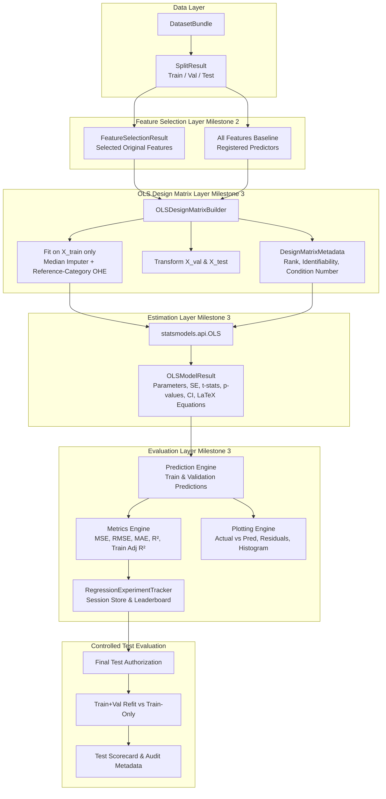

# OLS Regression Modeling Pipeline Architecture

This document describes the module structure, data contracts, and integration workflows for **Milestone 3** of the *Regression Learning Lab*.

---

## 1. System Architecture Overview



---

## 2. Core Python Modules & Responsibilities

| Module Path | Primary Class / Functions | Description |
| :--- | :--- | :--- |
| `src/models/design_matrix.py` | `OLSDesignMatrixBuilder`, `build_ols_design_matrices` | Transforms raw features into identifiable OLS design matrices with reference category encoding, intercept, rank evaluation, and condition number checks. |
| `src/models/model_result.py` | `OLSModelResult` | Typed data structure storing econometric coefficient tables, summary statistics, LaTeX equation strings, and performance scorecards. |
| `src/models/ols_model.py` | `fit_ols_model` | Fits `statsmodels.api.OLS` and extracts econometric parameters, standard errors, confidence intervals, and LaTeX formulas. |
| `src/models/model_service.py` | `train_ols_experiment` | High-level orchestrator connecting `SplitResult`, `FeatureSelectionResult`, design matrix construction, and model training. |
| `src/evaluation/regression_metrics.py` | `compute_regression_metrics`, `RegressionMetrics` | Calculates MSE, RMSE, MAE, $R^2$, and in-sample Adjusted $R^2$. |
| `src/evaluation/predictions.py` | `predict_ols` | Generates out-of-sample predictions on raw feature DataFrames via the fitted design matrix pipeline. |
| `src/evaluation/plots.py` | `plot_actual_vs_predicted`, `plot_residuals_vs_fitted`, `plot_residuals_histogram`, `plot_model_comparison_bar` | Interactive Plotly visualization suite for error analysis and model comparisons. |
| `src/evaluation/comparison.py` | `build_model_comparison_table` | Generates tabular comparison of models trained under the same split partition. |
| `src/experiments/regression_experiment_tracker.py` | `RegressionExperimentTracker` | Manages active models in session state, prevents cross-partition pollution, and oversees gated Test evaluation. |
| `pages/regression.py` | Streamlit Regression Page | Interactive laboratory for configuring features, inspecting design matrices, fitting OLS models, viewing LaTeX equations, and reading coefficient tables. |
| `pages/evaluation.py` | Streamlit Evaluation Page | Interactive dashboard for evaluating performance cards, scatter plots, residual distributions, model leaderboards, and controlled Test finalization. |

---

## 3. Data Contract: `OLSModelResult`

Every trained regression model produces an immutable `OLSModelResult` object:

```python
@dataclass
class OLSModelResult:
    model_id: str                              # e.g., "ols_d58ed755dadc"
    dataset_id: str                            # e.g., "student_performance"
    dataset_fingerprint: str                   # Cryptographic hash of data
    split_fingerprint: str                     # Cryptographic hash of split
    feature_source_id: str                     # "all_features" or exp_id
    feature_source_name: str                   # e.g. "Pearson Correlation (K=15)"
    target_name: str                           # Name of dependent variable
    selected_original_features: List[str]      # Selected original predictors
    design_matrix_metadata: DesignMatrixMetadata # Matrix dimensions, rank, reference categories
    coef_table: pd.DataFrame                   # Feature, Coef, SE, t-stat, p-value, 95% CI, Interpretation
    equation_general: str                      # General LaTeX equation
    equation_fitted: str                       # Fitted LaTeX equation with estimated parameters
    equation_text: str                         # Human-readable plain text equation
    train_metrics: RegressionMetrics           # MSE, RMSE, MAE, R², Train Adj R²
    val_metrics: RegressionMetrics             # MSE, RMSE, MAE, R² (no out-of-sample Adj R²)
    test_metrics: Optional[RegressionMetrics]  # Populated only upon authorized final test
    f_statistic: float                         # Overall model F-statistic
    f_pvalue: float                            # p-value for joint significance test
    post_selection_inference_warning: bool     # True if features were data-selected
    warnings: List[str]                        # Collinearity or degrees-of-freedom warnings
```

---

## 4. Integration with Milestone 2 Feature Selection

Milestone 3 seamlessly ingests the output of Milestone 2:

1. **Fingerprint Verification**:
   ```python
   if fs_result.split_fingerprint != split_result.split_fingerprint:
       raise ValueError("Split fingerprint mismatch: Outdated feature selection experiment.")
   ```
2. **Canonical Original Feature Handoff**:
   Rather than reusing the Milestone 2 predictive dummy column indices, Milestone 3 uses the `selected_original_features` list. It then constructs a dedicated OLS design matrix with **reference-category encoding** (`drop='first'`) so that all parameters remain identifiable in the presence of an intercept.
3. **Statistical Inference Notice**:
   Whenever a model is trained using a feature-selected subset, the educational notice is automatically attached to coefficient tables:
   > *"Coefficient tests and confidence intervals are conventional OLS results conditional on the selected model. They do not automatically adjust for data-driven feature selection."*

---

## 5. Handoff to Milestone 4: Statistical Assumption Diagnostics Laboratory

Fitted `OLSModelResult` instances seamlessly hand off to the Milestone 4 Diagnostics Engine (`src/diagnostics/`):

1. **Active Model Validation**:
   - `validate_active_model_for_diagnostics()` strictly compares model `dataset_id`, `dataset_fingerprint`, and `split_fingerprint` against the active session state.
   - Any stale or partition-mismatched model is blocked from executing diagnostic tests.
2. **Training-Only Scope & Leakage Protection**:
   - Diagnostic tests (Ramsey RESET, Durbin-Watson, Ljung-Box, Breusch-Pagan, Jarque-Bera, VIF) operate exclusively on training residuals and design matrix $X_{\text{train}}$.
   - Test labels and test residuals are never accessed or leaked during assumption evaluation.
3. **Prediction-Only vs. Inferential Guard**:
   - Models flagged as `prediction_only` (e.g. rank-deficient or singular matrices) restrict inferential hypothesis tests to exploratory / descriptive modes with educational explanations.
4. **Structured Artifacts**:
   - Each diagnostic produces an immutable `DiagnosticResult` record, assembled into a `DiagnosticSuiteResult` tracking full reproducibility metadata.
   - See [ASSUMPTION_DIAGNOSTICS.md](file:///d:/碩一/down_temp/classification/docs/ASSUMPTION_DIAGNOSTICS.md) and [DIAGNOSTIC_PIPELINE.md](file:///d:/碩一/down_temp/classification/docs/DIAGNOSTIC_PIPELINE.md) for full econometric details.
