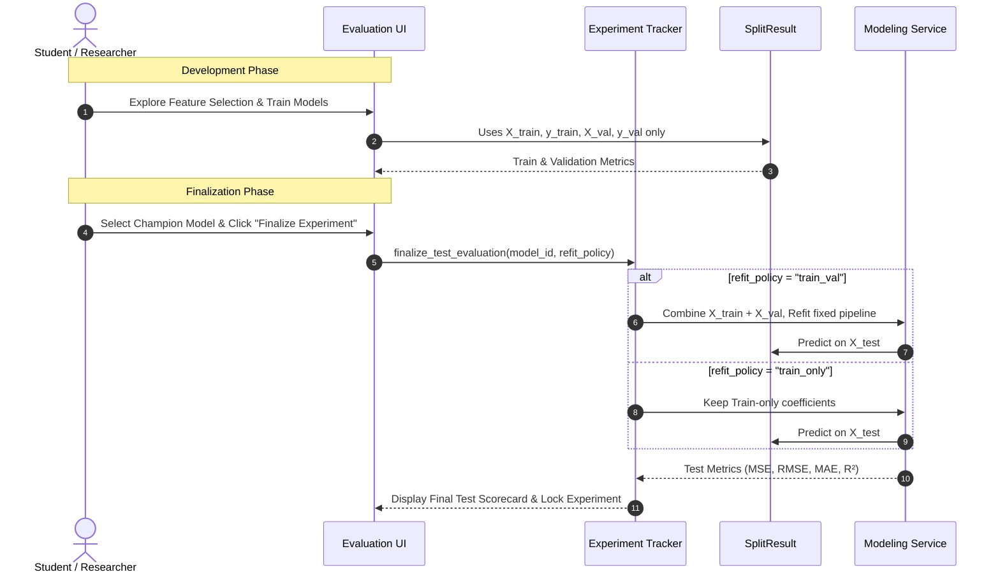

# Model Evaluation Methods & Generalization Assessment

This document provides the mathematical specifications, interpretative boundaries, and controlled testing protocols for the **Model Evaluation Laboratory (Milestone 3)** in the *Regression Learning Lab*.

---

## 1. Quantitative Regression Performance Metrics

Regression performance is quantified by comparing observed outcomes $y_i$ against fitted/predicted values $\hat{y}_i$.

### 1.1 Mean Squared Error (MSE)
The sample mean of squared prediction errors:

$$
\text{MSE} = \frac{1}{n} \sum_{i=1}^{n} (y_i - \hat{y}_i)^2
$$

- Heavily penalizes large outlying errors due to quadratic squaring.
- Expressed in squared target units.

### 1.2 Root Mean Squared Error (RMSE)
The square root of the mean squared error:

$$
\text{RMSE} = \sqrt{\text{MSE}} = \sqrt{\frac{1}{n} \sum_{i=1}^{n} (y_i - \hat{y}_i)^2}
$$

- Directly interpretable in the **natural units of the Target** (e.g., dollars of house sale price, years of life expectancy).
- Serves as the primary comparative error metric across models.

### 1.3 Mean Absolute Error (MAE)
The sample mean of absolute linear prediction errors:

$$
\text{MAE} = \frac{1}{n} \sum_{i=1}^{n} |y_i - \hat{y}_i|
$$

- Less sensitive to extreme outliers than RMSE, providing a robust measure of typical error magnitude.

### 1.4 Coefficient of Determination ($R^2$)
The proportion of total target variance explained by the model:

$$
R^2 = 1 - \frac{\sum_{i=1}^{n} (y_i - \hat{y}_i)^2}{\sum_{i=1}^{n} (y_i - \bar{y})^2} = 1 - \frac{\text{RSS}}{\text{TSS}}
$$

- **In-sample (Train)**: For an OLS model fitted with an intercept, $0 \le R^2 \le 1$.
- **Out-of-sample (Validation / Test)**: $R^2$ can be **strictly negative** ($R^2 < 0$) if the model predicts worse than the simple baseline predictor $\hat{y} = \bar{y}_{\text{eval}}$. Negative $R^2$ indicates severe generalization failure or severe overfitting.

### 1.5 In-Sample Adjusted $R^2$
Penalizes the addition of uninformative predictors under the classical OLS definition:

$$
R_{\text{adj}}^2 = 1 - (1 - R^2) \frac{n - 1}{n - p - 1}
$$

where:
- $n$ is the training sample size.
- $p$ is the number of non-intercept design matrix columns (including all dummy variables, not merely the original variable count).

> [!IMPORTANT]
> **Out-of-Sample Scope Notice**:
> Adjusted $R^2$ is an **in-sample criterion** derived from the unbiased estimators of error variance and total variance under OLS estimation. It is **not** mathematically meaningful or defined for out-of-sample validation or test data.
> The Regression Learning Lab computes $R_{\text{adj}}^2$ exclusively for Training Data, labeling it distinctly from validation metrics.

---

## 2. Generalization Gap & Overfitting Diagnostics

### 2.1 The Generalization Gap
The generalization gap measures the divergence between in-sample fit and out-of-sample prediction:

$$
\Delta_{\text{gen}} = \text{RMSE}_{\text{val}} - \text{RMSE}_{\text{train}}
$$

- $\Delta_{\text{gen}} \approx 0$: Balanced model generalizing well to unseen samples.
- $\Delta_{\text{gen}} \gg 0$: Potential **overfitting**, where the model has memorized sample-specific training noise at the expense of out-of-sample accuracy.
- **Educational Caveat**: A positive gap is not definitive proof of overfitting; distribution shifts across non-random splits (e.g., temporal or geographical partitions) naturally induce variance across folds.

---

## 3. Graphical Diagnostics (Descriptive Only)

Milestone 3 implements interactive visual inspections. These plots are **descriptive** tools for understanding error distribution and model limitations, not formal Gauss-Markov tests (which belong to Milestone 4).

### 3.1 Actual vs. Predicted Plot
- **X-axis**: Actual observed response $y$.
- **Y-axis**: Predicted response $\hat{y}$.
- **Reference Line**: Identity line $y = x$ (representing perfect predictions).
- **Interpretation**: Systematic curvature around the $45^\circ$ line suggests non-linear relationships. Dispersal at extreme target values highlights heteroskedasticity or poor boundary coverage.

### 3.2 Residuals vs. Fitted Plot
- **X-axis**: Fitted / predicted value $\hat{y}_i$.
- **Y-axis**: Raw residual $e_i = y_i - \hat{y}_i$.
- **Reference Line**: Horizontal zero baseline $e = 0$.
- **Interpretation**: Random scatter indicates that the linear specification is plausible. Funnel shapes indicate heteroskedasticity; U-shapes indicate unmodeled non-linearities.

### 3.3 Residual Distribution Histogram
- Plots the empirical density of residuals alongside an overlaid theoretical normal density curve $\mathcal{N}(0, s^2)$.
- Visualizes skewness, kurtosis, and heavy tails.

---

## 4. Controlled Final Test Evaluation Protocol

The Test dataset is held strictly sacred and isolated during all exploration, feature selection, and model tuning phases.

### 4.1 Strict Test Set Inviolability
1. Test data is never used to screen features, tune hyperparameters, or choose between models.
2. The UI hides Test evaluations until the student commits to a final model configuration.
3. Once authorized, the final evaluation produces an immutable record with audit metadata (`evaluated_train_val_refit` or `evaluated_train_only`).
