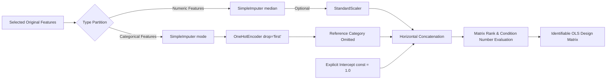

# Ordinary Least Squares (OLS) Regression Methods & Statistical Theory

This document provides the theoretical foundations, econometric formulations, numerical algorithms, and inferential caveats governing the **Multiple Linear Regression Modeling Laboratory (Milestone 3)** in the *Regression Learning Lab*.

---

## 1. Mathematical Formulation of Ordinary Least Squares

In multiple linear regression, the relationship between an observed continuous scalar response $y_i$ and a vector of $p$ explanatory predictor variables $\mathbf{x}_i = [x_{i1}, x_{i2}, \dots, x_{ip}]^\top$ is modeled as:

$$
y_i = \beta_0 + \sum_{j=1}^{p} \beta_j x_{ij} + \epsilon_i, \quad i = 1, \dots, n
$$

where:
- $\beta_0 \in \mathbb{R}$ is the constant intercept term (baseline response when all predictors equal zero).
- $\beta_j \in \mathbb{R}$ is the partial slope parameter for predictor $j$, representing the expected change in $y$ per one-unit increase in $x_j$, holding all other included predictors constant.
- $\epsilon_i$ is an unobserved random error disturbance.

In matrix notation for a sample of $n$ observations:

$$
\mathbf{y} = \mathbf{X}\boldsymbol{\beta} + \boldsymbol{\epsilon}
$$

where:
- $\mathbf{y} \in \mathbb{R}^{n \times 1}$ is the response vector.
- $\mathbf{X} \in \mathbb{R}^{n \times (p+1)}$ is the numerical design matrix (with leading column $\mathbf{1}_n$ for the intercept).
- $\boldsymbol{\beta} = [\beta_0, \beta_1, \dots, \beta_p]^\top \in \mathbb{R}^{(p+1) \times 1}$ is the coefficient vector.
- $\boldsymbol{\epsilon} \in \mathbb{R}^{n \times 1}$ is the disturbance vector.

### 1.1 The OLS Optimization Criterion
The Ordinary Least Squares estimator $\hat{\boldsymbol{\beta}}$ minimizes the Residual Sum of Squares (RSS):

$$
S(\boldsymbol{\beta}) = \sum_{i=1}^{n} (y_i - \mathbf{x}_i^\top \boldsymbol{\beta})^2 = (\mathbf{y} - \mathbf{X}\boldsymbol{\beta})^\top (\mathbf{y} - \mathbf{X}\boldsymbol{\beta})
$$

Differentiating with respect to $\boldsymbol{\beta}$ yields the normal equations:

$$
\mathbf{X}^\top \mathbf{X} \hat{\boldsymbol{\beta}} = \mathbf{X}^\top \mathbf{y}
$$

When the matrix $\mathbf{X}$ has full column rank, $\operatorname{rank}(\mathbf{X}) = p + 1$, the matrix $\mathbf{X}^\top \mathbf{X}$ is strictly positive definite and invertible, producing the unique analytical solution:

$$
\hat{\boldsymbol{\beta}} = (\mathbf{X}^\top \mathbf{X})^{-1} \mathbf{X}^\top \mathbf{y}
$$

### 1.2 Numerical Stability & Solvers
While the algebraic inverse $(\mathbf{X}^\top \mathbf{X})^{-1}$ illustrates the closed-form solution, computing explicit matrix inverses in floating-point arithmetic is numerically unstable and prone to catastrophic cancellation when condition numbers are high.

The Regression Learning Lab utilizes **statsmodels** and underlying SciPy/LAPACK routines which solve the normal equations via:
1. **QR Decomposition**: $\mathbf{X} = \mathbf{Q}\mathbf{R}$, where $\mathbf{Q}^\top \mathbf{Q} = \mathbf{I}$ and $\mathbf{R}$ is upper triangular. The solution is obtained via backward substitution: $\mathbf{R}\hat{\boldsymbol{\beta}} = \mathbf{Q}^\top \mathbf{y}$.
2. **Singular Value Decomposition (SVD)**: $\mathbf{X} = \mathbf{U}\boldsymbol{\Sigma}\mathbf{V}^\top$, providing maximum numerical stability and condition number monitoring.

---

## 2. Mandatory OLS Design Matrix Contract

The OLS Design Matrix Builder (`src/models/design_matrix.py`) transforms raw feature subsets into a statistically identifiable model matrix.

### 2.1 Numeric Features & Imputation
- Imputation parameters are strictly estimated on **Training Data** only:
  $$\hat{\mu}_{j,\text{med}} = \operatorname{median}(\mathbf{x}_{j,\text{train}})$$
- Missing values in Validation and Test sets are imputed using $\hat{\mu}_{j,\text{med}}$ to prevent data leakage.
- Scaling is configurable. In the educational UI, unscaled original units are preferred for direct interpretability (e.g., dollars per square foot, years of age).

### 2.2 Categorical Reference-Level Encoding
To include an intercept $\beta_0$ and prevent the **dummy-variable trap** (exact linear dependence where dummy indicators sum to the intercept vector $\mathbf{1}$), every categorical variable with $L$ discrete categories is represented by exactly $L - 1$ binary dummy columns:

$$
x_{i, \text{dummy}}^{(l)} = \begin{cases} 1 & \text{if observation } i \text{ possesses category } l \\ 0 & \text{otherwise} \end{cases}, \quad l \in \{2, \dots, L\}
$$

- The omitted category $l=1$ is designated as the **Reference Category**.
- The estimated coefficient $\hat{\beta}_{\text{dummy}}^{(l)}$ represents the expected difference in response relative to the reference category, holding all other included predictors constant.
- Unknown categories encountered at test/validation time are safely mapped to zeros (`handle_unknown='ignore'`), naturally falling back to the reference group baseline without raising runtime crashes.

### 2.3 Single Explicit Intercept Column
When `fit_intercept=True`, the builder prepends exactly one vector of ones (`const = 1.0`). Duplicate constants are strictly blocked.

---

## 3. Matrix Rank, Near-Singularity, and Identifiability

Ordinary Least Squares requires that no predictor is a linear combination of other predictors.

### 3.1 Identifiability & Rank Condition
Let $\mathbf{X} \in \mathbb{R}^{n \times P}$ where $P = p + 1$.
- **Full Column Rank**: $\operatorname{rank}(\mathbf{X}) = P$. In this regime, the parameters $\boldsymbol{\beta}$ are uniquely identified.
- **Rank Deficiency**: $\operatorname{rank}(\mathbf{X}) < P$. The system of normal equations possesses infinitely many solutions. Presenting pseudoinverse coefficients as unique causal effects is statistically invalid.

### 3.2 Real-World Structural Dependencies
In the **King County House Sales** dataset, the variables exhibit a known architectural identity:
$$\text{sqft\_living} \approx \text{sqft\_above} + \text{sqft\_basement}$$
On 21,611 of 21,613 records (99.99%), this identity is exact.
- If all three predictors are included simultaneously, the design matrix exhibits severe rank deficiency or extreme near-singularity with condition number $\kappa(\mathbf{X}) > 1.2 \times 10^4$.
- The builder detects this condition via SVD and QR column-pivoting, warning the student that coefficient variances inflate dramatically.

---

## 4. Econometric Inference: Standard Errors, t-Tests, and F-Tests

Under the classical Gauss-Markov assumptions:
1. $E[\boldsymbol{\epsilon} \mid \mathbf{X}] = \mathbf{0}$ (Strict exogeneity)
2. $\operatorname{Var}(\boldsymbol{\epsilon} \mid \mathbf{X}) = \sigma^2 \mathbf{I}_n$ (Homoskedasticity and no autocorrelation)
3. $\operatorname{rank}(\mathbf{X}) = P < n$ (Full column rank)
4. $\boldsymbol{\epsilon} \mid \mathbf{X} \sim \mathcal{N}(\mathbf{0}, \sigma^2 \mathbf{I}_n)$ (Normality of disturbances for exact finite-sample inference)

### 4.1 Covariance Matrix of Estimates
The unbiased estimator of error variance $\sigma^2$ is:

$$
s^2 = \frac{\text{RSS}}{n - P} = \frac{\sum_{i=1}^{n} (y_i - \hat{y}_i)^2}{n - p - 1}
$$

The parameter covariance matrix is:

$$
\widehat{\operatorname{Var}}(\hat{\boldsymbol{\beta}}) = s^2 (\mathbf{X}^\top \mathbf{X})^{-1}
$$

The standard error for coefficient $j$ is the square root of diagonal element $j$:

$$
\operatorname{SE}(\hat{\beta}_j) = \sqrt{\widehat{\operatorname{Var}}(\hat{\boldsymbol{\beta}})_{jj}}
$$

### 4.2 Individual Coefficient t-Tests
To test the null hypothesis $H_0: \beta_j = 0$ against $H_1: \beta_j \neq 0$:

$$
t_j = \frac{\hat{\beta}_j}{\operatorname{SE}(\hat{\beta}_j)} \sim t(n - p - 1)
$$

The two-sided p-value measures the probability of observing a test statistic at least as extreme as $|t_j|$ under $H_0$.

### 4.3 Confidence Intervals (95%)
$$
\text{CI}_{0.95}(\beta_j) = \left[ \hat{\beta}_j - t_{0.975, n-p-1} \cdot \operatorname{SE}(\hat{\beta}_j), \; \hat{\beta}_j + t_{0.975, n-p-1} \cdot \operatorname{SE}(\hat{\beta}_j) \right]
$$

### 4.4 Overall Model F-Test
To test the joint null hypothesis that all non-intercept slopes are simultaneously zero ($H_0: \beta_1 = \beta_2 = \cdots = \beta_p = 0$):

$$
F = \frac{\text{TSS} - \text{RSS}}{p} \Bigg/ \frac{\text{RSS}}{n - p - 1} = \frac{R^2 / p}{(1 - R^2) / (n - p - 1)} \sim F(p, n - p - 1)
$$

---

## 5. Post-Selection Inference Caveat

> [!WARNING]
> **Post-Selection Inference Notice**:
> When predictors are selected using the training data (e.g., via Pearson correlation, RFE, F-test, or Lasso), the conventional standard errors, $t$-statistics, and $p$-values calculated by statsmodels **do not account for the selection process**.
> 
> Testing hypotheses on the same dataset used to choose the "strongest" variables introduces selection bias: coefficients tend to be exaggerated (winner's curse), confidence intervals have lower than nominal coverage, and p-values are overly optimistic.
> 
> In Regression Learning Lab, these inferential statistics are explicitly labeled as **conventional results conditional on the chosen model**, and should not be interpreted as confirmatory evidence of causality.
